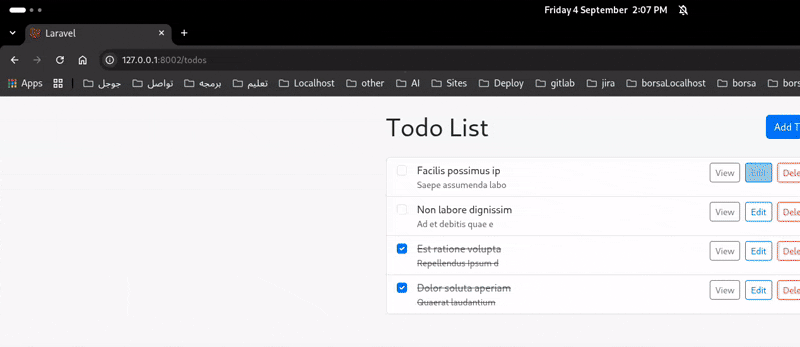

# Laravel Route Pattern Finder

A VS Code extension for Laravel developers that lists your routes exactly as `php artisan route:list` does, lets you filter them, and jumps straight to the matching controller or resource class.



## Features

- **Route search panel** — browse and filter all Laravel routes in a sidebar, with the same names you see in `route:list`.
- **Jump to the source** — click a route to open the controller method or resource class that handles it.
- **Find a Blade view in your code** — press `Ctrl+Shift+Q` (`Cmd+Shift+Q` on macOS) while any Blade file is open, and the extension converts its path to dot notation and searches for where that view is used in your PHP files.

## Commands

- `lrsearch: Open Laravel Route Search` — opens the route search panel.
- `Laravel: Search Blade View in Controllers` — searches for the currently open Blade view.

## Keyboard Shortcuts

| Shortcut | Action |
|----------|--------|
| `Ctrl+Shift+Q` / `Cmd+Shift+Q` | Search for the currently open Blade view in controllers |

## Usage

1. Open your Laravel project in VS Code.
2. Open the **Laravel Search** icon in the Activity Bar to see all routes and filter them.
3. Open any Blade file under `resources/views` and press `Ctrl+Shift+Q` to find where that view is referenced in the application code.

## Development

```bash
cd extension
npm install
```

Then press `F5` in VS Code to launch the extension in an Extension Development Host.

## Packaging

```bash
cd extension
vsce package
```

## Publish

```bash
cd extension
vsce publish
```
